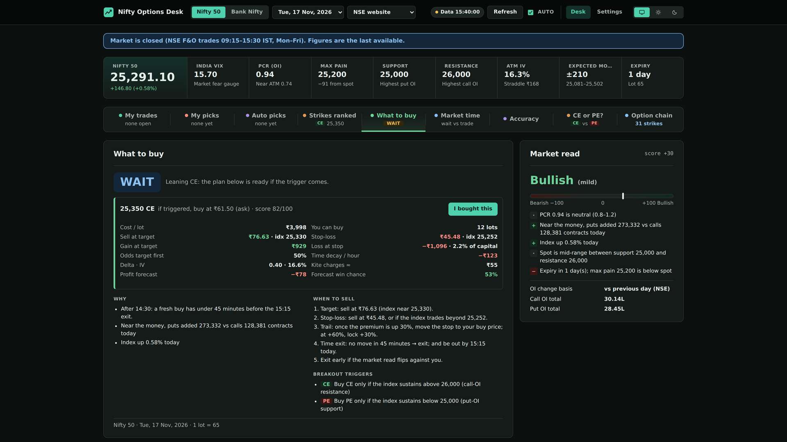
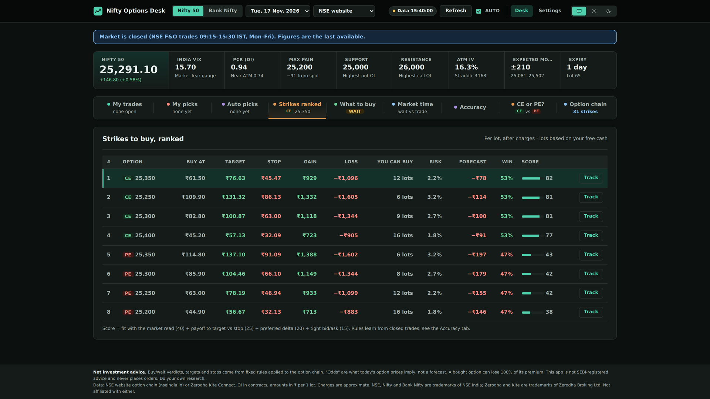
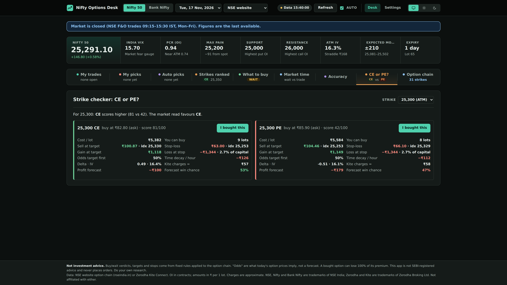
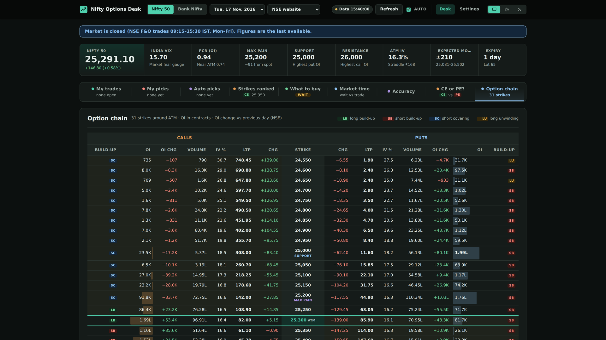
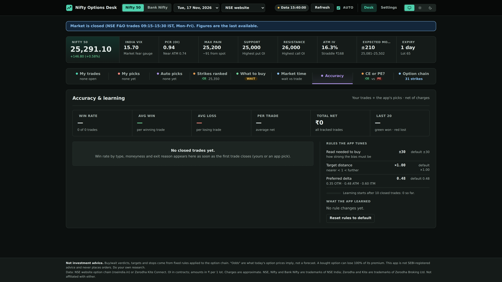

# Nifty Options Desk

A free Windows desktop helper for people who **buy** Nifty 50 and Bank Nifty options. It reads NSE's live option
chain and turns it into one clear answer: **BUY CE, BUY PE or WAIT**, which strike to buy, and where to take profit
or cut the loss.

Coming to the Microsoft Store (product `9PB1WM53L3JR`).

## Features

- BUY CE / BUY PE / WAIT verdict from open interest, the put-call ratio and the time of day, with the reasons
  spelled out. No buys in the opening minutes, late in the day or on expiry afternoon.
- Strikes to buy, ranked per lot after charges, with how many lots your capital allows.
- Target, stop and trailing stop for every strike, in premium and in index points, plus the time to exit.
- CE or PE? Pick any strike and see which side is the better buy right now.
- Live option chain around the money: OI, OI change, IV and prices.
- Paper trading: **My picks** (trades you save) and **Auto picks** (the app's own picks), closed automatically on
  target, stop, trail or time, with capital, win rate and profit after Zerodha-style charges.
- Market time: how much of the session had a trade worth buying and how much was a wait.
- Accuracy and learning: the rules tune themselves slowly after enough closed trades.
- Optional Zerodha Kite Connect data source with your own keys. Light and dark themes.

| | |
|---|---|
|  |  |
|  |  |

## Honest by design

- Chances shown are what today's option prices imply, not a forecast. A bought option can lose all of its premium.
- The app never places orders and needs no account. Your trades, settings and optional Kite keys stay on your PC.
- It names itself honestly to NSE; it never pretends to be a web browser.

## Privacy

See [PRIVACY.md](PRIVACY.md). The app collects nothing.

## Support

Open an issue: <https://github.com/buildsbeyondai-code/nifty-options-desk/issues>.

## Disclaimer

Information only. Not investment advice and not SEBI-registered advice. NSE, Nifty and Bank Nifty are trademarks of
National Stock Exchange of India Ltd.; Zerodha and Kite are trademarks of Zerodha Broking Ltd. This app is not
affiliated with either.

© 2026 Jude Finney (buildsbeyondAI). The source code is private.
